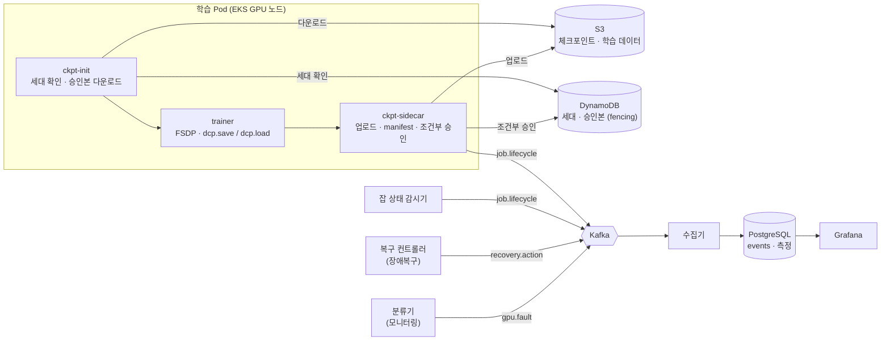

# GPU Failover — Data

GPU 학습 중 장애가 나도 **마지막으로 승인된 체크포인트에서 다른 클러스터로 이어서 학습**하게 만드는 프로젝트의 **데이터 파트** 레포입니다.

체크포인트 저장 · 재개 규약, 장애 사건 수집(Kafka), 사건 저장 · 측정(PostgreSQL)을 담당합니다.

> 담당: 김현수 (데이터 파트)

---

## 한눈에 보기



전체 서비스 흐름(제출 → 배치 → 학습 → 장애 감지 → 복구 → 재개 → 측정)은 Confluence **서비스 Workflow** 문서에 그림으로 정리돼 있습니다.

---

## 담당 범위

| 영역 | 하는 일 | 위치 |
|---|---|---|
| **체크포인트** | 학습 상태를 S3에 저장하고, 승인된 것만 재개에 쓰도록 보장. 옛 세대가 늦게 쓰는 것을 막음(fencing) | 학습 Pod의 init · 사이드카, S3, DynamoDB |
| **사건 수집 (Kafka)** | 장애 · 복구 · 잡 상태 사건을 한 형식으로 모아 전달 | 온프레미스 Kafka 브로커(KRaft) |
| **사건 저장 · 측정 (DB)** | 사건을 DB에 쌓고 MTTD · MTTR · ETTR 계산 | 매니저 클러스터 수집기, 온프레미스 PostgreSQL 16 |
| **학습 환경 (trainer)** | 학습 Pod의 trainer 이미지(torch · CUDA · transformers)와 기본 `train.py`. 사용자가 올린 train.py는 `/data/code/train.py`로 들어온다 | `trainer/`, `ghcr.io/devoops-team/trainer` |
| **보조 도구** | 실험용 시나리오 데이터 준비(trace 가공) | 오프라인 스크립트 |

---

## 구현 기능

### 1. 체크포인트 모듈 (`ckpt-init`, `ckpt-sidecar`)

학습 코드(trainer)는 **로컬 `/ckpt`에 저장 · 불러오기만** 합니다. S3 · DynamoDB와의 통신은 전부 init 컨테이너와 사이드카가 맡습니다.

**용어**
- **세대(generation)**: 잡을 다시 띄울 때마다 +1 되는 번호. DynamoDB가 원본.
- **승인본**: 모든 rank의 파일이 S3에 올라가고 manifest 검증이 끝나 DynamoDB에 기록된 체크포인트. 재개는 승인본으로만 함.
- **fencing**: 세대가 바뀐 뒤 옛 세대 Pod가 쓰기 · 승인을 못 하게 막는 것.

**저장 순서**
1. trainer(모든 rank): DCP로 `/ckpt`에 조각 저장 → 완료 표시 파일 생성
2. 각 사이드카: DynamoDB 세대 확인. 내 세대가 아니면 `STOP` 후 종료
3. 각 사이드카: 자기 조각을 S3에 업로드 + rank별 업로드 목록 작성
4. rank 0 사이드카: rank 목록이 다 모이면 `manifest.json` 작성 · 검증 → **조건부 승인**(DynamoDB `generation = 내 세대`일 때만)
5. 승인 사건 발행, 로컬은 최근 N개만 유지

**재개 순서**
1. ckpt-init: 환경 변수 세대 = DynamoDB 세대인지 확인 (다르면 시작 안 함)
2. ckpt-init: 승인본 manifest의 파일 전부 · 학습 데이터 · `config.json`을 S3에서 받아 체크섬 확인
3. trainer: 로컬 체크포인트를 불러와 다음 step부터 학습

**S3 경로 구조**
```
s3://<체크포인트 버킷>/
  code/{job_id}/config.json · jobset.json
  datasets/{ds-id}/v{n}/...
  jobs/{job_id}/gen-0002/step-00001200/
    manifest.json           # 파일 목록 · 크기 · sha256 · config_sha256 · 이미지 digest
    ranks/rank-0000.json    # rank별 업로드 목록
    .metadata, __0_0.distcp, ...   # FSDP(DCP) 조각
```

### 2. 사건 수집 (Kafka)

| 토픽 | 생산 | 소비 | 파티션 키 |
|---|---|---|---|
| `gpu.fault` | 분류기 (모니터링) | 복구 컨트롤러, 수집기 | 노드 |
| `recovery.action` | 복구 컨트롤러 | 수집기 | 잡 ID |
| `job.lifecycle` | 잡 상태 감시기, 사이드카 | 수집기 | 잡 ID |
| `fault.injection` | 장애 주입 도구 | 수집기 | 노드 |
| `monitoring.log` | 모니터링 | 수집기 | 노드 |

**공통 사건 형식 (envelope)**
```json
{
  "event_id": "uuid",
  "schema_version": 1,
  "type": "fault.detected",
  "occurred_at": "2026-11-16T10:03:08.123Z",
  "source": "classifier@cluster-a",
  "cluster": "cluster-a",
  "node": "ip-10-0-1-23",
  "job_id": "job-7",
  "generation": 1,
  "payload": { "category": "hardware", "xid": 79 }
}
```
- 시각은 UTC · 밀리초. `occurred_at`(봉투 시각)이 측정 기준
- 전달: 최소 한 번(at-least-once) + 소비 측 `event_id` 중복 제거

### 3. 수집기 (Kafka → PostgreSQL)

1. Kafka에서 묶음으로 읽기
2. `INSERT … ON CONFLICT (event_id) DO NOTHING` (같은 사건 두 번 와도 1건)
3. DB 저장 후 오프셋 커밋
4. 형식 오류 사건은 `event_rejects`에 원본 보관

### 4. 데이터 DB 스키마 (`db/001_init.sql`)

| 테이블 / 뷰 | 내용 |
|---|---|
| `events` | 사건 원본 (모든 측정의 출처) |
| `event_rejects` | 형식 오류 사건 |
| `experiments` | 실험 조건 (정책 · 장애 종류 · 예비 노드 유무 · 세이브 주기) |
| `job_runs` | 세대별 실행 (제출 · 시작 · 종료 시각, 종료 사유) |
| `checkpoints` | 승인된 체크포인트 (크기 · 저장 · 업로드 시간) |
| `results` | 실험별 측정 결과 |
| `v_incidents` | 장애 1건 단위 감지 · 분류 · 복구 시간 |

### 5. 측정 지표

| 지표 | 계산 |
|---|---|
| **MTTD** (평균 감지 시간) | 평균(첫 감지 사건 시각 − 장애 시작 시각) |
| **MTTR** (평균 복구 시간) | 평균(분류 시간 + 복구 시간) = 장애 시작 → 학습 재개 |
| **ETTR** (유효 학습 시간 비율) | (할당 시간 − 정지 시간 − 재계산 시간) ÷ 할당 시간 |
| 날아간 학습량 | 고장 시점 step − 마지막 승인 step |
| 수집 지연 | 분류기 판정 시각 − 원본 신호 시각 |

장애 시작 시각: 주입 실험은 주입 시각, 자연 장애는 원본 로그 시각.

---

## 디렉터리 구조

```
Data/
├── db/                 # DB 마이그레이션 (001_init.sql ...)
├── checkpoint/         # (예정) ckpt-init · ckpt-sidecar
├── collector/          # (예정) Kafka → PostgreSQL 수집기
├── trainer/            # 학습 환경 이미지 · 기본 train.py (GPU-154, Backend에서 이전)
├── schemas/            # (예정) 사건 envelope · 토픽별 payload 스키마
└── tools/              # (예정) trace 가공 · 시나리오 생성
```

---

## 진행 상황

| 항목 | 상태 |
|---|---|
| Kafka 브로커 설치 (KRaft 단일 노드) · JMX Exporter | 완료 |
| PostgreSQL 16 설치 · 스키마 적용 (`001_init.sql`) · Grafana 읽기 전용 계정 | 완료 |
| 체크포인트 규약 · JobSet 템플릿 합의 | 확정 |
| 체크포인트 모듈 로컬 동작 (init · 사이드카) | 다음 주 |
| 수집기 | 다음 주 |
| Kafka 3중화 (KRaft HA) · DB S3 백업 | 검토 중 |

---

## 주요 결정 (ADR)

| ADR | 내용 |
|---|---|
| ADR-6 | 세대 번호의 원본은 DynamoDB |
| ADR-7 · ADR-8 | 사건 전달은 Kafka |
| ADR-10 | 체크포인트 승인은 DynamoDB, 재시작마다 세대 +1 |
| ADR-12 | JobSet 공용 템플릿, 제출본을 복구 원본으로 |
| ADR-14 | 학습 데이터 저장소는 S3 (EFS 안 씀) |
| ADR-15 | 측정 지표는 MTTD · MTTR · ETTR, 봉투 시각 기준 |

상세 내용은 팀 Confluence(GPUF 스페이스)의 ADR 목록 참고.

---

## 다른 파트와의 연결

| 파트 | 주고받는 것 |
|---|---|
| 서비스 · 학습 | `config.json` · `jobset.json` 생성, trainer의 DCP 저장 · 불러오기 |
| 스케줄링 (Kueue · MultiKueue) | 재제출 JobSet 배치, 잡 투입기 |
| 장애복구 | 세대 +1, 옛 실행 중단 → 재제출, `recovery.action` 발행 |
| 모니터링 | `gpu.fault` 발행, 측정 시간 정의, Grafana 패널 |
| 인프라 | S3 · DynamoDB 권한, VPN, VM |

---

## 브랜치 규칙

- `develop`: 작업 브랜치. 여기로 push
- `main`: `develop` → `main` PR로만 반영
